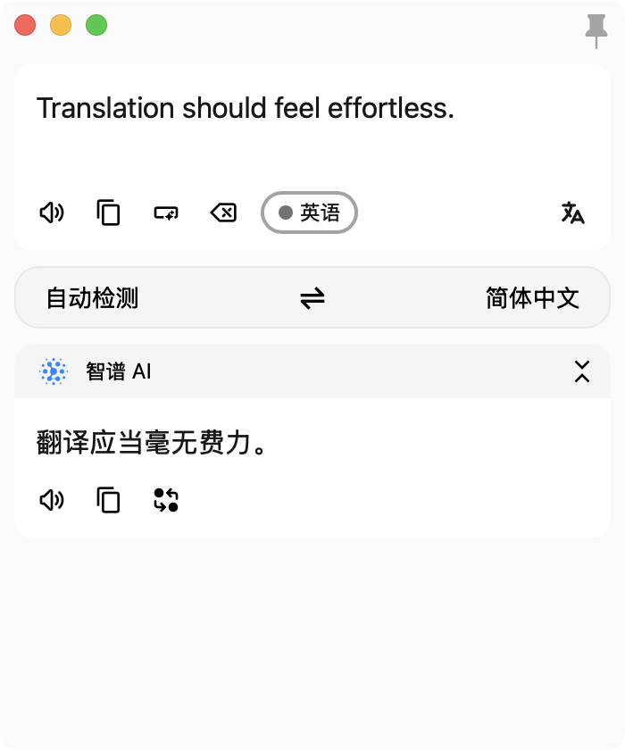
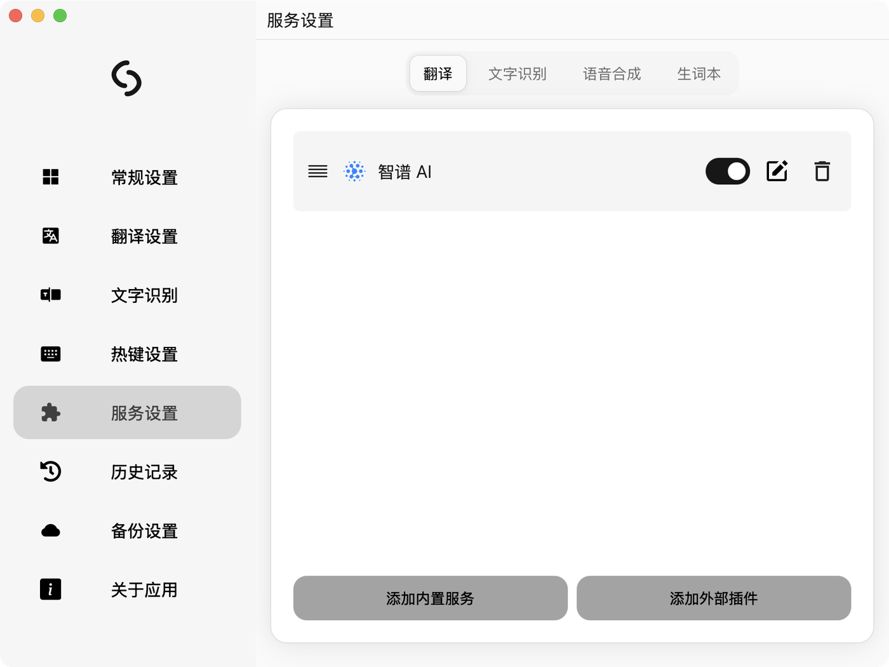
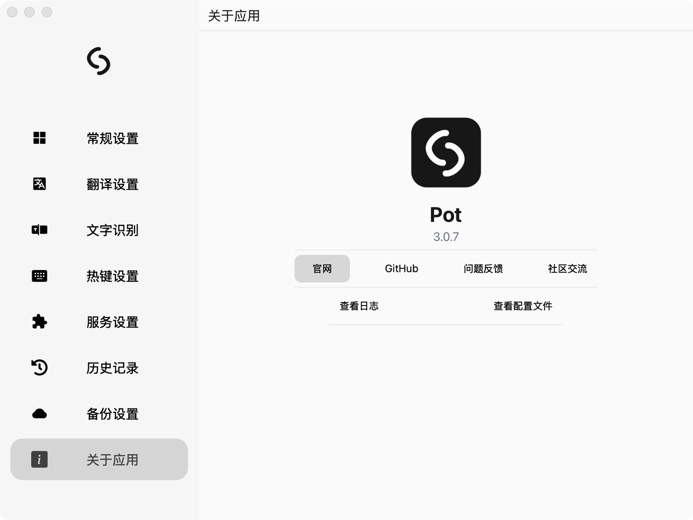

<div align="center">


# Pot

跨平台划词翻译工具 · 黑白单色界面

基于 [pot-app/pot-desktop](https://github.com/pot-app/pot-desktop) 3.0.7（GPL-3.0）

</div>

---

## 界面

<p align="center">
  
</p>

选中文字按 `⌘ + M` 即可翻译。原文和译文分开显示，可一键复制、朗读、回译。

<p align="center">
  
</p>

<p align="center">
  
</p>

---

## 怎么用

### 划词翻译

在任何应用里选中文字，按 `⌘ + M`，翻译窗口会在鼠标位置弹出。

如果不习惯快捷键，可以在 **设置 → 热键设置** 里改。

### 输入翻译

点击菜单栏图标，选「输入翻译」，直接打字翻译。

### 截图翻译

菜单栏图标 →「截图翻译」，框选屏幕区域，自动 OCR 后翻译。

### 剪贴板监听

菜单栏图标 →「监听剪贴板」，之后每次复制文字都会自动翻译。

---

## 配置翻译服务

首次使用需要配置一个翻译服务。**设置 → 服务设置 → 翻译**，点「添加内置服务」。

### 智谱 AI（推荐，免费）

1. 到 [智谱开放平台](https://open.bigmodel.cn/) 注册，获取 API Key
2. 设置里选「智谱 AI」，填入 Key
3. 模型选 `glm-4-flash-250414`（免费、速度快）

> 本项目已修复原版智谱服务不可用的问题，详见 [MODIFICATIONS.md](./MODIFICATIONS.md)。

### 其他服务

支持 DeepL、有道、百度、腾讯、阿里、OpenAI 兼容接口、Ollama 本地模型等 20+ 服务。
也可以点「添加外部插件」安装社区翻译插件。

---

## 常用设置

| 位置 | 说明 |
|---|---|
| 常规设置 | 开机自启、监听端口、语言、主题、字体大小 |
| 翻译设置 | 服务排序、自动复制、窗口行为、增量翻译 |
| 文字识别 | OCR 引擎（系统 / Tesseract） |
| 热键设置 | 划词翻译、输入翻译、截图识别的快捷键 |
| 服务设置 | 翻译 / 识别 / 语音 / 生词本服务配置 |
| 历史记录 | 所有翻译记录，可搜索 |
| 备份设置 | WebDAV 备份配置 |

---

## 快捷键

| 功能 | 默认快捷键 |
|---|---|
| 划词翻译 | `⌘ + M` |
| 输入翻译 | 未设置 |
| 截图翻译 | 未设置 |
| 截图识别 | 未设置 |

全部可在 **设置 → 热键设置** 中修改或清空。

---

## 构建

```bash
pnpm install
pnpm tauri build --bundles app
```

环境要求：Node.js `^22.23.4 || ^24.22.1 || >=26.12.1`、pnpm、Rust stable。

### macOS 注意事项

划词翻译需要**辅助功能**权限：系统设置 → 隐私与安全性 → 辅助功能，添加 pot.app。

> 该权限按代码签名绑定。未签名的本地构建每次重新编译都会改变标识，
> 导致权限反复失效。解决方式见 [MODIFICATIONS.md](./MODIFICATIONS.md#macos-签名说明)。

---

## 与原版的区别

- 黑白单色界面（移除原来的青色/蓝色强调色）
- 修复智谱 AI 翻译（原版填了正确 Key 也无法使用）
- 移除强制更新弹窗（上游推送 4.0.0 改名通知）
- 新图标

完整改动见 [MODIFICATIONS.md](./MODIFICATIONS.md)。

---

## 许可

[GPL-3.0](./LICENSE) · 原始代码版权归 [pot-app](https://github.com/pot-app/pot-desktop) 所有
